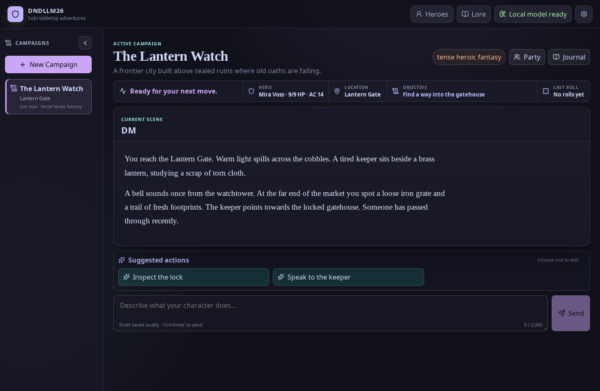

# DNDLLM26

A solo D&D inspired game with an AI Dungeon Master. Create a party, choose how to act and roll for uncertain outcomes. The game owns dice, combat, resources and progression. The model narrates the world and proposes story updates.



## Start playing

Install [uv](https://docs.astral.sh/uv/), [Bun](https://bun.sh/) and [Node.js 24](https://nodejs.org/), then run this from the project folder.

```bash
bun run start
```

The launcher installs the locked dependencies, builds the interface and opens the local app. Use `bun run dev` for frontend reloads and backend reloads on macOS and Linux. Choose **Configure model** on the welcome screen or open **Settings** from the top bar. Enter a model ID or select a suggestion. The rules and memory field can use the same model as the Dungeon Master.

## Default model

The default is local Ollama. Start it first and pull these models if you want the defaults.

```bash
ollama pull llama3.2:3b
ollama pull llama3.2:1b
ollama pull nomic-embed-text
```

## Use another provider

Copy `.env.example` to `.env` in the project folder. In PowerShell use `Copy-Item .env.example .env`. Set the provider, restart the game and choose a model shown by your server or account.

| Provider ID | Runtime and configuration |
| --- | --- |
| `ollama` | Native API at `http://127.0.0.1:11434`. The original `OLLAMA_*` variables still work. |
| `lmstudio`, `llamacpp`, `vllm`, `localai`, `koboldcpp` | OpenAI compatible server on loopback. Default ports are 1234, 8080, 8000, 8080 and 5001. Start or load a chat model on your server first. |
| `openai`, `anthropic`, `gemini` | OpenAI Chat Completions, native Claude Messages and Gemini’s OpenAI compatibility API. |
| `openrouter`, `deepseek`, `xai`, `mistral`, `groq` | Hosted OpenAI compatible endpoints. Select a chat model ID from your provider. |
| `together`, `fireworks`, `cerebras`, `perplexity`, `huggingface` | Hosted OpenAI compatible endpoints. Availability depends on the account and model. |
| `azure` | Set `LLM_BASE_URL` to the Azure resource endpoint ending in `/openai/v1` and use the deployment name as the model ID. |
| `compatible` | Set `LLM_BASE_URL` to any server exposing streamed `/chat/completions`. Include its API prefix, usually `/v1`. Use this for custom gateways. |

The main provider references are [Ollama](https://docs.ollama.com/api/chat), [OpenAI](https://developers.openai.com/api/reference/resources/chat/subresources/completions/methods/create), [Claude](https://platform.claude.com/docs/en/api/messages), [Gemini](https://ai.google.dev/gemini-api/docs/openai), [LM Studio](https://lmstudio.ai/docs/developer/openai-compat) and [Azure OpenAI](https://learn.microsoft.com/en-us/azure/foundry/openai/latest).

For LM Studio, one local setup without Ollama is:

```dotenv
LLM_PROVIDER=lmstudio
LLM_EMBED_PROVIDER=disabled
```

For a hosted model, `LLM_ALLOW_REMOTE=true` enables the connection. Set `LLM_API_KEY` in `.env` or the server process environment. The browser never receives this value.

```dotenv
LLM_PROVIDER=anthropic
LLM_ALLOW_REMOTE=true
LLM_API_KEY=replace_with_your_key
LLM_EMBED_PROVIDER=disabled
```

Hosted chat sends relevant campaign history, player actions and retrieved lore passages to the configured provider. Choose a locally served model to keep that processing on your device. The default embedding endpoint remains Ollama. Set `LLM_EMBED_PROVIDER=same` if the chat endpoint also serves embeddings, `compatible` to use a separate OpenAI compatible embedding endpoint, or `disabled` to play without PDF search. Remote embeddings require `LLM_ALLOW_REMOTE_EMBEDDINGS=true` because indexing sends document text. Claude provides chat only. For a separate endpoint set `LLM_EMBED_BASE_URL` and, where required, `LLM_EMBED_API_KEY`.

`LLM_CHAT_MODEL`, `LLM_UTILITY_MODEL` and `LLM_EMBED_MODEL` provide initial defaults. The model preferences you save apply to that pair of endpoints. If discovery is unavailable, you can still enter the IDs manually. For streamed narration the server needs to send protocol completion events. Gateway-specific models and routes may differ in support.

## Campaigns and PDF lore

The party, encounters, saves and original PDFs live in the local `data/` directory. Close the game before backing up that directory. Schema 8 saves upgrade in place to schema 9. Older or structurally incompatible databases are refused and left available for backup.

The first run with an embedding model requeues existing LanceDB lore records for indexing in SQLite. Original PDFs and campaign links remain available. The old LanceDB files are no longer read. After checking the new indexes, you can archive the old `data/lancedb/` directory if you use the default paths. `LANCEDB_DIR` remains supported as an alias for `LORE_INDEX_DIR`.

PDF lore is optional. Upload a text PDF in the Lore Library, allow it to index, then attach it when creating a campaign. Scanned documents need OCR first. By default the worker accepts 32 MiB per PDF and 400 pages, with a 45 second extraction deadline.

Engine progress is saved after each action. An interrupted narration can be retried from the same turn. When the engine already resolved dice, the retry reuses that result.

## Development

Python 3.11 through 3.14, Bun and Node.js 24 are supported for development. Use the default loopback binding. See [SECURITY.md](SECURITY.md) for the trust model.

```bash
bun run check
uv audit --locked
cd frontend && bun audit
```

The API schema is available at `http://127.0.0.1:8765/api/openapi.json`. Run `uv run --locked dndllm26-integrity` to check campaign database integrity.

## Licence

See [LICENSE](LICENSE).
